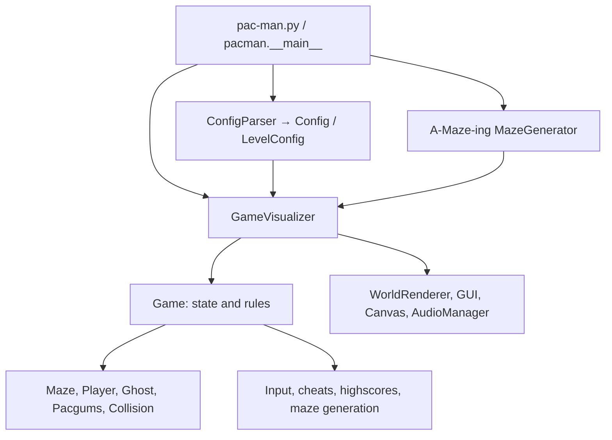

*This project has been created as part of the 42 curriculum by hfujisad,shanazaw.*

# Pac-Man

## Description

Pac-Man is a Python maze game built with MiniLibX (MLX). Its goal is to
recreate the main Pac-Man mechanics while using the assigned A-Maze-ing
package to generate the playing field.

Collect every normal and super pacgum to clear a level while avoiding four
ghosts with different pursuit strategies. Super pacgums make ghosts edible
for five seconds. Scores and remaining lives carry over between levels;
losing every life or running out of time ends the game. The supplied
configuration contains ten levels with increasing maze sizes and time limits.

The game includes a home menu, instructions, a local top-ten leaderboard,
pause and resume, selectable maze colors, music, sound effects, and a cheat
mode for testing and evaluation.

## Instructions

### Requirements

- Python **3.14 or newer**, as specified in [pyproject.toml](pyproject.toml).
- [uv](https://docs.astral.sh/uv/getting-started/installation/) and `make`.
- Linux x86_64 with an accessible X11 display, or WSL with WSLg.
- The shared libraries required by the bundled MLX build: `libxcb`,
  `libxcb-keysyms`, `libvulkan`, `libz`, and `libbsd`, plus a working Vulkan
  driver. A software Vulkan driver can also be used.

Audio is optional: if the audio device or an audio asset cannot be opened,
the game prints a warning and continues without sound.

### Install and run from source

Run these commands from the repository root:

```bash
make install
.venv/bin/python pac-man.py config.json
```

`make install` synchronizes the Python dependencies and installs the two
bundled wheels from `src/`: `mlx-2.2-py3-none-any.whl` and
`mazegenerator-2.1.0-py3-none-any.whl`. These wheels are installed separately
from the dependencies declared in `pyproject.toml`. No separate compilation
step is needed to run the Python source with these wheels.

The program requires exactly one argument: the configuration file path.
These equivalent commands are also available after installation:

```bash
make run
make run CONFIG=path/to/other.json
.venv/bin/python -m pacman config.json
```

Configuration paths and relative highscore paths are resolved from the
current working directory. An unreadable configuration file, invalid UTF-8,
invalid JSON, or a JSON root other than an object produces an error and exit
code `1`. Ctrl+C exits with code `130`.

### Development and packaging

| Command | Purpose |
| --- | --- |
| `make debug` | Install dependencies and run under Python's `pdb` debugger. |
| `make lint` | Run flake8 and mypy with the project's required flags. |
| `make lint-strict` | Run flake8 and mypy in strict mode. |
| `make build` | Build `dist/pac-man/` with PyInstaller and copy the configuration. |
| `make package` | Create `dist/pac-man-linux.zip`, including a launcher and user guide; requires `zip`. |
| `make clean` | Remove caches and build/package output. |
| `make fclean` | Also remove the virtual environment. |

Download page: [Pac-Man on itch.io](https://hyoka7.itch.io/pac-man).

The build configuration is [pac-man.spec](pac-man.spec). The packaged game
does not require a Python installation, but still needs the display, system
libraries, and Vulkan driver listed above. Extract the archive into an empty
directory and run `./play.sh`; an optional argument selects another config
file. The launcher changes to its own directory, so the default score file
is stored beside the executable. See [the packaged user guide](packaging/README.txt).

### Controls

Key labels below are shown in uppercase for readability; Shift is only
needed when entering an uppercase player name.

| Screen | Keys | Action |
| --- | --- | --- |
| Any screen | Esc | Quit. |
| Home | Up / Down, Enter | Select and open Start, Instruction, Ranking, or Exit. |
| Home | I / H | Open instructions / ranking directly. |
| Instructions / Ranking | Enter | Return home. |
| Ranking | C | Open the confirmation to clear all scores. |
| Clear confirmation | Y / N | Clear and save / cancel. |
| Ready / Stage Clear | Any key except Esc | Start playing / continue to the next level. |
| Playing | Arrow keys / WASD | Move or request the next turn. |
| Playing | P / C | Pause / cycle maze colors. |
| Paused | P / H | Resume / return home. |
| Game Over / All Clear | Letters, digits, spaces, Backspace | Edit a name of up to ten characters. |
| Game Over / All Clear | Enter | Submit the score and return home. |

During play, type `3111696` to toggle cheat mode. When enabled, the HUD
shows `CHEAT ON` and the following controls are available:

| Key | Effect |
| --- | --- |
| N | Advance to the next level. |
| F | Freeze or unfreeze ghosts. |
| H | Toggle walking through walls, within the maze boundary. |
| K | Toggle protection from ghost collisions. |
| V | Toggle faster player movement. |
| L | Add one life. |
| T | Add ten seconds to the current level. |
| X | Toggle a 1x / 10x multiplier for future points. |

Turning cheat mode off restores normal movement speed, collision handling,
wall checks, ghost movement, and score multiplier. Frozen ghosts can still
collide with the player.

## Configuration

The configuration is a UTF-8 JSON object. Whole lines beginning with `#`,
after optional whitespace, are ignored. Inline comments are not supported;
`#` characters inside JSON strings are preserved. Unknown keys are ignored.

Missing or invalid fields produce warnings on stderr and fall back
individually, preserving valid settings. An absent, empty, or invalid
`levels` list uses the ten default levels. Within a valid list, a non-object
entry becomes a default `LevelConfig`; missing or invalid fields in a level
are corrected separately.

| Top-level key | Fallback default | Meaning and constraints |
| --- | --- | --- |
| `highscore_filename` | `"scores.json"` | Score file path; a relative path uses the working directory. Its parent directory must exist and be writable to save. |
| `lives` | `3` | Initial lives; integer, at least 1. |
| `seed` | `42` | Seed for level one; integer, at least 1. |
| `points_per_pacgum` | `10` | Points for a normal pacgum; integer, at least 1. |
| `points_per_super_pacgum` | `50` | Points for a super pacgum; integer, at least 1. |
| `points_per_ghost` | `200` | Points for an eaten ghost; integer, at least 1. |
| `levels` | Ten levels shown below | Nonempty array of level objects, played in order. |

| Key within a level | Fallback default | Meaning and constraints |
| --- | --- | --- |
| `width` | `15` | Number of columns; integer from 15 to 30 inclusive. |
| `height` | `15` | Number of rows; integer from 15 to 30 inclusive. |
| `max_time` | `90.0` | Time limit in seconds; finite number, at least 90. |

The supplied [config.json](config.json) has the following values. Its seed
is **4**; the fallback used when `seed` is missing or invalid is **42**.
The ten supplied level sizes and timers also define the default level list.

```json
{
  "highscore_filename": "scores.json",
  "lives": 3,
  "seed": 4,
  "points_per_pacgum": 10,
  "points_per_super_pacgum": 50,
  "points_per_ghost": 200,
  "levels": [
    {"width": 15, "height": 15, "max_time": 90.0},
    {"width": 17, "height": 15, "max_time": 100.0},
    {"width": 19, "height": 17, "max_time": 110.0},
    {"width": 21, "height": 17, "max_time": 120.0},
    {"width": 21, "height": 19, "max_time": 130.0},
    {"width": 23, "height": 19, "max_time": 140.0},
    {"width": 25, "height": 21, "max_time": 150.0},
    {"width": 25, "height": 23, "max_time": 160.0},
    {"width": 27, "height": 25, "max_time": 170.0},
    {"width": 30, "height": 27, "max_time": 180.0}
  ]
}
```

## Highscore

`HighscoreManager` loads the configured JSON file when the game is created.
It validates entries with Pydantic, sorts them by descending score, and
keeps only the top ten. Equal scores retain their existing insertion order.
Names must contain 1–10 ASCII letters, digits, or spaces, and scores must
be nonnegative integers.

At Game Over or All Clear, press Enter to submit the score. An empty name
becomes `Anonymous`. Submission updates the ranking and saves it immediately.
Quitting or returning home from pause does not submit a score. The ranking
screen shows the top ten; C followed by Y clears and saves an empty ranking.

The file structure is:

```json
{
  "scores": [
    {"name": "Alice", "score": 1200},
    {"name": "Bob", "score": 800}
  ]
}
```

JSON was chosen because a ten-entry local leaderboard is small, easy to
inspect, and does not need a database or online service. Validation keeps
malformed entries out of the ranking. Saving writes a temporary file in
the same directory and then uses `os.replace()` to replace the destination
atomically, reducing the risk of leaving a partially written score file.

A missing file starts an empty ranking. Invalid JSON, invalid entries,
invalid UTF-8, and file read errors are reported without stopping the game;
the original file is not modified during loading. If saving encounters an
OS error, the game reports it and retains the updated ranking in memory.

## Maze Generation

The project uses the assigned **A-Maze-ing** package supplied as
[mazegenerator 2.1.0](src/mazegenerator-2.1.0-py3-none-any.whl).
The package is installed and used as supplied; game-specific navigation
and rendering are implemented in `pacman/`.

At startup, `pacman.__main__` creates a `MazeGenerator` with the first
level's `(width, height)` and calls `generate(seed=config.seed)`. For a
new game or level, `Game.regenerate_maze()` constructs a generator for that
level; its constructor generates the grid. Level one always uses the
configured positive seed, including on restart. Later levels use `seed=0`,
which asks this package to reseed randomly.

The calls rely on the package's default `perfect=False`. This generates
mazes with loops and removes dead ends from playable corridors, providing
alternative routes for pursuit and escape. The package also inserts the
central `42` pattern. Its entry-to-exit solution is not used as the game's
win condition: the player must collect all pacgums.

The returned `generator.maze` is a two-dimensional grid of wall masks:

| Direction | Wall bit |
| --- | --- |
| North | `1` |
| East | `2` |
| South | `4` |
| West | `8` |

A set bit blocks movement; `15` is a fully closed cell. `Maze` copies and
validates the grid, then calculates breadth-first-search (BFS) distances
from every open cell. Ghost strategies reuse these distances during play.
When the dimensions change, the visualizer recalculates cell size and
offsets before the game places characters and pacgums.

## Implementation

- **Game lifecycle:** `GameState` represents menus, Ready, Playing, Pause,
  Stage Clear, All Clear, Game Over, and ranking-clear confirmation.
  `Game.update_game()` advances rules only during Playing, so pause also
  stops the level timer and power-up timers. Collecting the last pacgum
  takes priority over timeout in the same update.
- **Movement and collisions:** `Player` and `Ghost` compose a shared
  `Movement` object. Speeds are measured in cells per second and converted
  to pixel movement using elapsed time and the current cell size. Turns
  are requested through the player, and `Maze` checks walls and bounds.
  `Collision` compares the distance between character centers with the
  sum of their radii.
- **Collectibles and lives:** `Pacgums` stores cell coordinates in sets and
  excludes the player's starting cell. Super pacgums occupy the corners
  and grant five seconds of power. An eaten ghost returns to its spawn
  cell and waits five seconds before becoming active. Losing a life
  resets character positions and returns to Ready; the level's score and
  collected pacgums are retained.
- **Ghost decisions:** Red uses `BFSStrategy` to chase the player, pink uses
  `AmbushStrategy` to target up to three open cells ahead, and orange uses
  `ReverseAmbushStrategy` to target behind. Cyan uses `InkyStrategy`,
  reflecting the red ghost's position around a point two cells ahead of
  the player and selecting a reachable target. Pursuit chooses randomly
  among equally short next steps. During a power-up, ghosts use
  `FleeBFSStrategy` to increase their distance from the player.
- **Rendering:** MLX owns the window, events, and image buffer. Pillow
  generates text and character images, which are cached and composited
  into the buffer. The complete frame is sent to the window once per draw.
  Static screens redraw on changes or expose events; gameplay redraws
  continuously. Layout adapts the maze to the display and reserves space
  for the HUD and power-up bar.
- **Audio and distribution:** `AudioManager` uses the pygame-ce mixer for
  background tracks and effects, disabling audio on initialization or
  loading errors. PyInstaller bundles the application, MLX library, font,
  and audio assets using the root spec file.

## General Software Architecture

Game rules and state are separated from MLX window management and drawing.
`GameVisualizer` owns a `Game`, forwards keyboard events, passes elapsed
time to updates, and coordinates rendering and audio. State-specific input
handlers return `WindowAction` requests for window-level actions such as
closing the window or changing colors.



| Module | Main classes and responsibility |
| --- | --- |
| `pac-man.py`, `pacman/__main__.py` | Command-line entry points; parse configuration, generate the initial maze, and start the visualizer. |
| `pacman/parser/`, `pacman/models/` | `ConfigParser`, `Config`, and `LevelConfig`: read, validate, and recover configuration fields. |
| `pacman/game/game.py`, `state.py` | `Game` owns the level lifecycle and game objects; `GameState` identifies the active screen or phase. |
| `pacman/game/maze.py`, `directions.py` | `Maze` owns walls and cached BFS distances; shared direction offsets and wall bits define navigation. |
| `pacman/game/player.py`, `ghost.py`, `movement.py` | `Player` and `Ghost` own character state and reuse `Movement`. Each ghost delegates decisions to a strategy. |
| `pacman/game/strategy.py`, `pacgums.py`, `collision.py` | Replaceable direction strategies, collectible management, and contact detection. |
| `pacman/controls/` | State-specific key handling, key mappings, `CheatHandler`, and `WindowAction` requests. |
| `pacman/storage/highscore.py` | `ScoreEntry`, `HighscoreData`, and `HighscoreManager`: validated JSON persistence and top-ten ranking. |
| `pacman/visualize/` | `GameVisualizer` manages MLX; `WorldRenderer` draws the world; `GUI` draws screens and HUD; `Canvas` exposes the buffer and coordinate conversions; `ImageRenderer` and `sprites` create and compose cached images. |
| `pacman/audio/`, `pacman/types.py`, `stubs/` | Audio playback, shared coordinate/color types, and typing declarations for the external packages. |

The game classes do not operate MLX windows or GUI screens. Movement still
uses the `Canvas` coordinate-conversion interface, so placement follows a
defined order: generate the maze, update the canvas geometry, then call
`Game.place_level()`.

## Project Management

Development was organized into small steps: movement and maze integration,
game rules and ghost behavior, menus and persistence, rendering and audio,
then configuration, error handling, static checks, and packaging. Progress
notes recorded decisions, verification results, and the next work to resume;
Git commits recorded individual changes.

The dedicated [project management directory](project_management/README.md)
summarizes the workflow, implementation milestones, and verification
approach. The repository's Git history records the individual changes.

## Resources

### Documentation and references

- [Python 3.14 documentation](https://docs.python.org/3.14/) — language,
  standard library, typing, and JSON/file handling.
- [Python `collections.deque`](https://docs.python.org/3.14/library/collections.html#collections.deque)
  — the queue used by the maze's BFS distance calculation.
- [MiniLibX Linux source and manuals](https://github.com/42Paris/minilibx-linux)
  — background on the MLX API. This project runs the supplied Python MLX
  wheel, whose metadata and bundled documentation describe its specific API.
- [Pydantic models](https://docs.pydantic.dev/latest/concepts/models/)
  — configuration and highscore validation and serialization.
- [Pillow Image reference](https://pillow.readthedocs.io/en/stable/reference/Image.html)
  — image creation and alpha compositing.
- [pygame-ce mixer reference](https://pyga.me/docs/ref/mixer.html)
  — audio initialization, sound effects, and music playback.
- [uv installation guide](https://docs.astral.sh/uv/getting-started/installation/)
  — environment and dependency tooling.
- [Assigned A-Maze-ing wheel](src/mazegenerator-2.1.0-py3-none-any.whl)
  — includes package metadata documenting the generator API, wall encoding,
  and seed behavior; [local type declarations](stubs/mazegenerator/__init__.pyi)
  describe the API consumed by this project.

### AI use

AI assistance was used for discussing design and explaining code, reviewing
and debugging behavior, and implementing requested refactors. The recorded
work includes separating game rules, input, and rendering into the current
`pacman/` modules; clarifying types, names, and docstrings; and investigating
movement, ghost strategies, configuration/seed handling, highscore errors,
rendering performance, and startup/audio failures.

AI also wrote and maintained local headless regression tests, helped with
flake8/mypy checks and packaging, and rewrote this README by comparing the
documentation with the implementation. The local tests are excluded from
the submitted Git repository, so a fresh clone does not contain that test
suite.

### Asset credits

The game uses **Press Start 2P** by The Press Start 2P Project Authors
(Copyright 2012), distributed through
[Google Fonts](https://fonts.google.com/specimen/Press+Start+2P) under the
[SIL Open Font License 1.1](assets/fonts/OFL.txt).

| Use | Work | Author | Source |
| --- | --- | --- | --- |
| Menu music | 8 Bit Arcade | moodmode | [Pixabay](https://pixabay.com/music/video-games-8-bit-arcade-138828/) |
| Playing music | Chipped urgency(combat), loop version | Centurion_of_war | [OpenGameArt](https://opengameart.org/content/chipped-urgencycombat) |
| Pacgum effect | Retro Coin 1 | Driken5482 | [Pixabay](https://pixabay.com/sound-effects/film-special-effects-retro-coin-1-236677/) |
| Power-up effect | Retro powerup 1 | Driken5482 | [Pixabay](https://pixabay.com/sound-effects/retro-powerup-1-236686/) |
| Ghost-eating effect | Retro blip | Driken5482 | [Pixabay](https://pixabay.com/sound-effects/film-special-effects-retro-blip-236676/) |
| Game-over music | Game over - retro video game 1 | ejah_music | [Pixabay](https://pixabay.com/music/video-games-game-over-retro-video-game-1-422479/) |

The OpenGameArt track is CC0; the listed Pixabay assets use the Pixabay
Content License. File mappings and license references are recorded in
[the audio source notes](assets/audio/README.md). Asset licenses are separate
from the project's source code.
